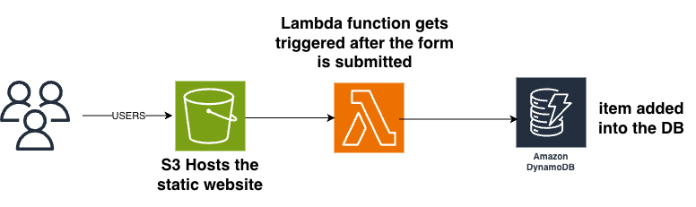

# AWS Serverless Customer Registration App

A hands-on AWS project demonstrating how to build a simple serverless application using Amazon S3, AWS Lambda, Amazon DynamoDB, and AWS Identity and Access Management (IAM).

The application allows a user to submit customer information through a web form. The browser sends the data to a Lambda Function URL, where a Python function validates the request and stores the record in DynamoDB.

## Architecture

**Key architectural principle:** The browser communicates with Lambda, and Lambda communicates with DynamoDB. The frontend never accesses the database directly.

Amazon S3 serves the frontend files; it does not trigger the Lambda function in this architecture.

## AWS Services Used

| Service | Responsibility |
|---|---|
| Amazon S3 | Hosts the static HTML and JavaScript frontend |
| AWS Lambda | Validates incoming requests and processes customer data |
| Amazon DynamoDB | Stores customer and order records |
| AWS IAM | Controls the permissions granted to the Lambda function | Controls the Bucket Policy
| Lambda Function URL | Provides an HTTP(S) endpoint for invoking the function |

## Database Design

**Table:** `Customers`

The table uses a composite primary key:

| Attribute | Key type | Data type |
|---|---|---|
| `CustomerID` | Partition key | Number |
| `OrderID` | Sort key | Number |
| `Name` | Regular attribute | String |
| `Email` | Regular attribute | String |

Using both keys together allows a customer to have multiple orders while keeping each customer/order combination unique.

The complete primary key must be unique for each item. A repeated write to the same key can replace the existing item unless conditional-write logic prevents it.

## Application Workflow

1. A user opens the static website hosted on Amazon S3.
2. The user enters information into the customer form.
3. JavaScript collects the form values and serializes them as JSON.
4. The browser sends an HTTP request to the Lambda Function URL.
5. Lambda parses and validates the incoming data.
6. Lambda uses its execution role to write the item to DynamoDB.
7. The function returns a success or error response.
8. The webpage displays the result to the user.

## Security and Permissions

### Lambda execution role

The Lambda function uses an IAM execution role with narrowly scoped permissions to write items to the intended DynamoDB table.

The principle of least privilege means granting only the actions and resources required by the function.

### Lambda resource-based policy

The Function URL was configured without authentication for this learning project. Its resource-based policy allows public invocation through the URL.

**Security warning:** Anyone who obtains the endpoint may be able to invoke the function. Public access can lead to unwanted requests, abuse, and unexpected costs.

### Cross-Origin Resource Sharing (CORS)

CORS was configured to allow the origin of the S3-hosted webpage to make browser requests to the Lambda Function URL.

CORS is a browser security mechanism, not an authentication system. It does not stop direct HTTP requests made by tools such as `curl` or scripts outside the browser.

### S3 bucket policy

The S3 bucket was configured for static website hosting with public access to the website files.

This is suitable for a learning exercise, but production hosting should consider a private S3 bucket behind Amazon CloudFront with Origin Access Control, HTTPS, and a more restrictive access policy.

## Testing and Troubleshooting

The application was tested in layers to help isolate failures.

1. **Lambda console test:** Checked function execution and the DynamoDB write path.
2. **HTTP endpoint test:** Used `curl` to test the Function URL independently of browser CORS enforcement.
3. **Browser integration test:** Submitted the form through the actual website to verify the frontend and cross-origin request.
4. **Database verification:** Inspected DynamoDB table items to confirm that the record was persisted.
 

## Potential Improvements

The following are future improvements, not claims about the current implementation:

- Add authentication and appropriate authorization.
- Introduce request throttling and abuse protection.
- Add stronger input validation and conditional writes.
- Host the frontend through CloudFront with a private S3 bucket.
- Add automated tests and infrastructure as code.
- Improve error handling, monitoring, and alarms.
- Avoid logging unnecessary customer information.
- Monitor usage and cost.

## Cleanup

After completing the lab, review the AWS resources created for the project and remove those no longer needed. Verify that any public endpoints and public bucket access are disabled or removed when the application is no longer in use.

## What This Project Demonstrates

This project provided hands-on practice with:

- Serverless application architecture
- AWS Lambda and Function URLs
- DynamoDB table and primary-key design
- IAM permissions and least privilege
- S3 static website hosting
- Browser CORS behavior
- Layered testing and troubleshooting
- Security considerations for publicly accessible applications

**Project status:** Learning project. Production hardening remains future work.
